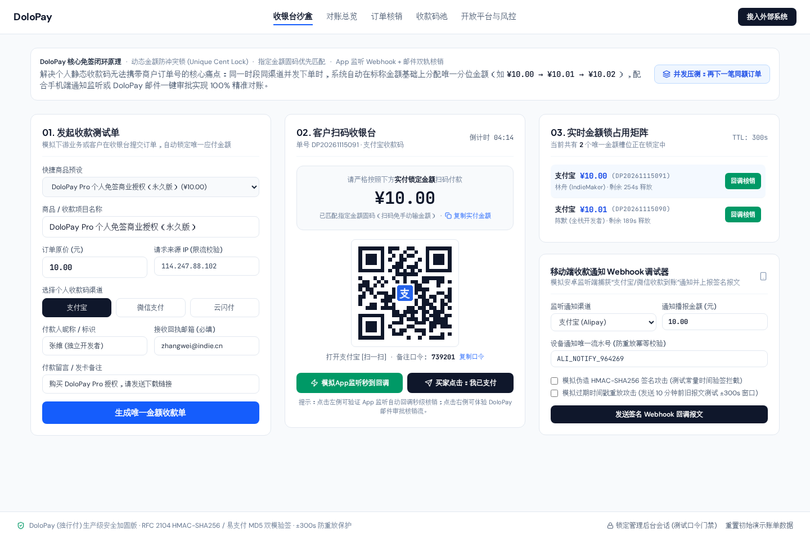
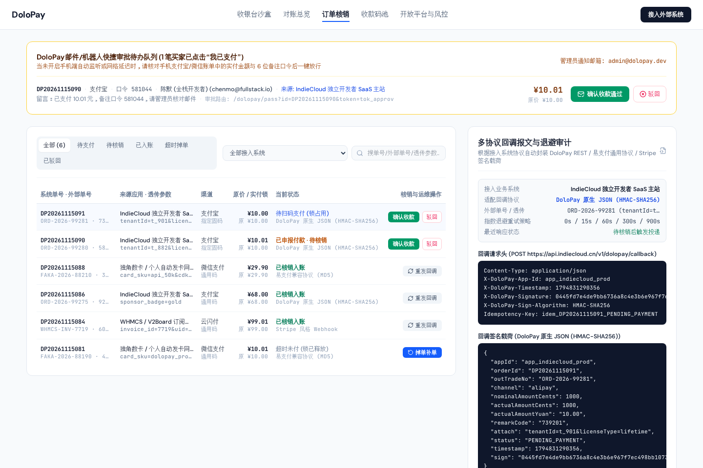
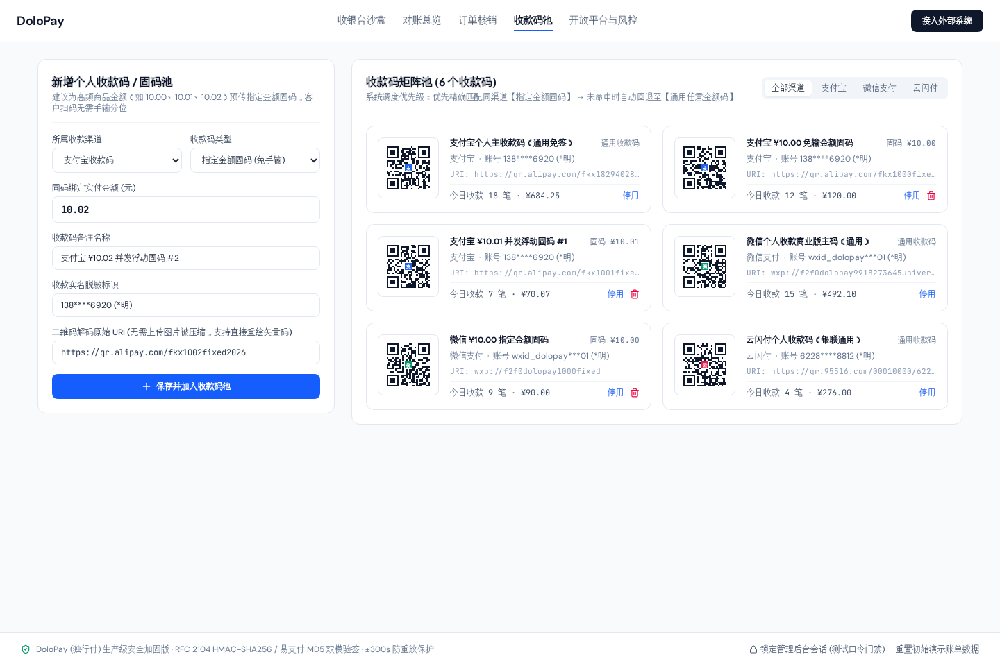
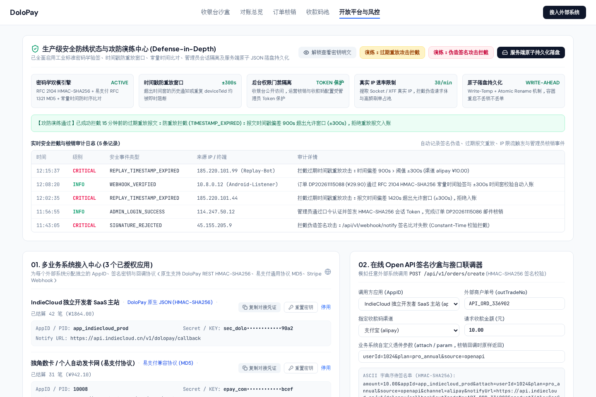

<div align="center">

**简体中文** | [English](./README_EN.md)

# DoloPay (独行付)

**个人收款码免签约收款与多协议开放网关**  
*Personal QR Code Payment & Multi-Protocol Open Gateway for Indie Hackers*

[](./LICENSE)
[](./tsconfig.json)
[](#)
[](#四-外部系统接入指南-open-api--插件配置)

**无需企业营业执照 · 0% 通道手续费 · 资金 100% 实时直达个人支付宝 / 微信支付 / 云闪付账户**  
内置整数分位原子防冲突锁、高频固码池优先匹配、App 监听与邮件/飞书双轨核销，零代码兼容易支付通用协议与任意外部系统。

</div>

---

## 📸 界面预览 (Screenshots)

### 1. 收银台沙盒与实时金额锁矩阵
> 支持一键发起并发同额压测、客户扫码收银台倒计时、唯一分位锁实时占用监控及移动端通知 Webhook 签名调试。



### 2. 全功能运营与开放网关矩阵

| 对账总览与三网清算分布 | 订单核销与多协议回调报文审计 |
| :---: | :---: |
|  |  |
| **个人收款码与高频固码池矩阵** | **开放平台、多系统接入与多语言 SDK 生成器** |
|  |  |

---

## 一、 为什么需要 DoloPay？

个人开发者在商业化初期常面临两难困境：官方企业支付接口需要营业执照与对公账户，而第三方聚合代收平台存在高额抽成、T+N 提现冻结甚至跑路风险。

传统个人静态收款码虽然支持 0 手续费直达个人账户，但存在两大工程痛点：
1. **无订单号透传**：客户扫静态码付款后，账单通知仅有“到账 X.XX 元”，当同一时段有多人购买同价位商品（如 `¥10.00`）时，无法区分是哪位客户的订单。
2. **缺乏标准异步回调网关**：无法与下游 SaaS 系统、发卡网、订阅面板自动联动发卡或开通会员。

**DoloPay (独行付)** 从金融级稳定性出发，通过**整数分位原子防冲突锁 + 高频固码池优先匹配 + App 监听与邮件/飞书双轨核销 + 多协议开放网关**，彻底解决个人收款码自动化对账与跨系统集成难题。

---

## 二、 核心架构与四大防掉单机制

```text
+-----------------------------------------------------------------------------------+
│                        外部业务系统 (Downstream Applications)                       │
│   [自研 SaaS / 独立站]         [独角数卡 / 鲸发卡 / V2Board]       [WHMCS / 国际订阅]   │
+-------------+------------------------------+------------------------------+-------+
              │ 1. DoloPay REST v1           │ 2. 易支付通用协议 (EPay Compat) │ 3. Stripe Webhook
              v                              v                              v
+-----------------------------------------------------------------------------------+
│                          DoloPay Open Gateway (server.ts)                         │
│  - 多应用鉴权 (AppID + AppSecret)        - ASCII 字典序签名校验 & Idempotency 幂等保护  │
│  - 业务透传参数保留 (attach / param)      - 指数退避重试 (0s / 15s / 60s / 300s / 900s) │
+--------------------------------------------+--------------------------------------+
                                             │
                                             v
+-----------------------------------------------------------------------------------+
│                        DoloPay 核心防冲突与调度引擎 (Core Engine)                    │
│  [整数分位原子锁] 同渠道并发 ¥10.00 -> 自动锁定 ¥10.00 / ¥10.01 / ¥10.02 (TTL 到期自动回收) │
│  [收款码矩阵调度] 优先精确匹配【指定金额免输固码】 -> 未命中时自动回退【通用收款码 + 6位口令】 │
│  [防刷限流风控]   单 IP 并发待付上限拦截 + 分位区间耗尽保护 + 零 IEEE 754 浮点数精度误差   │
+----------------------+-----------------------------------------+------------------+
                       │                                         │
        通道 A：全自动秒级回调 (主力)               通道 B：人工/半自动兜底 (双活容灾)
                       v                                         v
+--------------------------------------+   +----------------------------------------+
│ 移动端收款通知监听 (Android / Tasker)  │   │ 邮件 / 飞书 / Bark / Telegram 快捷审批 │
│ 捕获支付宝/微信到账通知 -> HMAC 签名上报 │   │ 买家点击“我已支付” -> 一键点击签名链接放行 │
+--------------------------------------+   +----------------------------------------+
```

### 1. 整数分位原子防冲突锁 (Unique Cent Lock Pool)
- **零浮点误差**：全链路基于整数分（Cents）运算（如 `1001` 分 = `¥10.01`），彻底杜绝 JavaScript/IEEE 754 浮点数精度偏移导致的金额匹配失败。
- **并发防碰撞**：当 `支付宝 ¥10.00` 槽位被占用时，后续并发订单按所选策略（向上 `+0.01` 递增或向下 `-0.01` 随机立减）自动分配 `¥10.01`、`¥10.02`。
- **TTL 自动回收**：订单核销成功或超时（默认 300 秒）后立即释放分位锁归还池中。

### 2. 高频指定金额固码池 + 通用收款码双层调度
- **痛点消除**：客户扫通用码时若忘记手动输入 `.01` 分位尾数会导致无法自动匹配。
- **优先固码匹配**：支持在【收款码池】中为高频商品金额（如 `¥10.00 ~ ¥10.05`）预先录入**指定金额固码**。客户扫码后无需手动输入金额即可直接支付；未命中固码时自动回退至通用收款码并生成 6 位防伪备注口令。

### 3. App 监听 Webhook + 邮件/IM 机器人双轨核销
- **全自动模式**：闲置安卓机运行 `NotificationListenerService` / `Tasker` 捕获支付宝、微信收款通知，携带 `HMAC` 签名与设备通知唯一流水号（防重放幂等校验）上报至 `/api/v1/webhook/notify`，实现秒级入账与自动发卡。
- **DoloPay 快捷审批流 + 多通道推送**：即使监听手机断电或断网，买家点击“我已支付”后系统立即向管理员邮箱、**飞书群机器人、Bark (iOS 强提醒)、钉钉、Telegram** 推送含专属 `approvalToken` 的一键审批链接，手机点按即可完成核销与补单。

### 4. 三大工业级开放协议无缝集成
- **DoloPay REST Open API v1**：标准 JSON + ASCII 字典序签名 + `Idempotency-Key` 幂等头。
- **易支付通用协议 (`EPay Compat`)**：零代码直接对接 **独角数卡、鲸发卡、V2Board、SSPanel、WHMCS、WordPress/WooCommerce** 等任何支持标准 EPay 插件的开源系统。
- **Stripe 风格签名事件流 (`Stripe Webhook`)**：采用 `X-DoloPay-Signature: t=...,v1=...` 时间戳签名头。

---

## 三、 快速开始与本地运行

### 1. 环境要求
- Node.js `>= 20.x`
- npm `>= 9.x`

### 2. 安装与启动

```bash
# 克隆仓库
git clone https://github.com/your-org/dolopay.git
cd dolopay

# 安装依赖
npm install

# 启动全栈开发服务器 (Express Open Gateway + Vite 前端控制台，默认端口 3000)
npm run dev
```

### 3. 运行核心引擎单元测试

```bash
npx --yes tsx --test src/core/dolopayEngine.test.ts
```

---

## 四、 外部系统接入指南 (Open API & 插件配置)

### 方式 A：零代码对接现成开源系统（易支付通用协议兼容模式）

在【开放平台与风控】中新建一个协议为 `易支付通用协议 (EPay Compat)` 的应用，然后将以下三项填入您的发卡网（如独角数卡）或面板后台：

| 配置项 | 填写内容 |
| :--- | :--- |
| **接口地址 (API URL)** | `https://your-dolopay-domain.com/api/v1/epay/` |
| **商户 ID (PID)** | 应用分配的 `AppID`（如 `10008`） |
| **商户密钥 (KEY)** | 应用分配的 `AppSecret` |

---

### 方式 B：标准 REST Open API v1 接入（适合自研系统）

#### 1. 创建唯一金额锁收款单
- **请求路径**：`POST /api/v1/orders/create`
- **Content-Type**：`application/json`

**请求参数：**

```json
{
  "appId": "app_indiecloud_prod",
  "outTradeNo": "ORD_20261115_001",
  "channel": "alipay",
  "amount": "10.00",
  "productTitle": "DoloPay Pro 商业授权",
  "attach": "userId=1024&plan=pro_annual",
  "notifyUrl": "https://api.yoursite.com/webhooks/dolopay",
  "sign": "adab34d558cf25435d602842d3f44eef78b37de18ecee44a49d188b75c11600e"
}
```

**签名算法 (`computeCanonicalOpenApiSign`)：**
1. 过滤掉空值、`sign` 和 `sign_type` 字段；
2. 将所有非空请求参数按照参数名 **ASCII 字典序升序**排列，拼接为 `k1=v1&k2=v2...`；
3. 在末尾拼接 `&key=<您的 AppSecret>` 得到待签名串；
4. 计算签名值并填入 `sign`。

**成功响应示例：**

```json
{
  "code": 0,
  "msg": "success",
  "data": {
    "orderId": "DP20261115101",
    "outTradeNo": "ORD_20261115_001",
    "channel": "alipay",
    "nominalAmountYuan": "10.00",
    "actualPayAmountYuan": "10.01",
    "floatDeltaCents": 1,
    "qrMatchType": "FIXED_EXACT",
    "qrPayloadUrl": "https://qr.alipay.com/fkx1001fixed2026",
    "remarkCode": "581044",
    "attach": "userId=1024&plan=pro_annual",
    "expiresAt": 1794811800000,
    "cashierUrl": "/?orderId=DP20261115101"
  }
}
```

#### 2. 接收异步回调通知 (Merchant Webhook)
当订单核销到账后，DoloPay 会向您的 `notifyUrl` 发送 `POST` 请求（失败时按 `0s / 15s / 60s / 300s / 900s` 指数退避重试）：

- **请求头**：
  - `X-DoloPay-App-Id`: `app_indiecloud_prod`
  - `X-DoloPay-Timestamp`: `1794811542137`
  - `X-DoloPay-Signature`: `<64位签名>`
  - `Idempotency-Key`: `idem_DP20261115101_PAID`

---

## 五、 生产环境纵深安全防线与部署建议 (Defense-in-Depth)

### 1. 内置 5 层白盒级安全防线（即使攻击者拥有完整源码亦无法绕过核销）

1. **标准密码学双模引擎 + 常量时间比对 (`Constant-Time Comparison`)**：
   - `DOLOPAY_REST_V1`、`STRIPE_WEBHOOK` 及移动端通知上报全面采用符合 **RFC 2104 标准的 `HMAC-SHA256`**；
   - `EPAY_COMPAT`（易支付通用协议）采用符合 **RFC 1321 标准的 `MD5`**，零代码兼容独角数卡、鲸发卡、V2Board 等现成插件；
   - 所有签名比对强制执行 `constantTimeEqual` 逐字节常量时间异或校验，彻底杜绝时序侧信道攻击（Timing Side-Channel Attack）。
2. **Webhook `±300s` 时间戳防重放窗口 + 设备通知唯一指纹幂等**：
   - 移动端上报 `/api/v1/webhook/notify` 时，网关首先校验 `|now - timestamp| <= 300s`，过期重放报文直接以 `TIMESTAMP_EXPIRED` 拦截并记入安全审计日志；同时通过 `deviceTxId` 幂等校验防止同一笔通知重复入账。
3. **前台收银台与后台管理端 Token 权限隔离 + 状态机单向锁**：
   - 客户扫码收银台保持公开访问，但公开接口严格脱敏（绝不返回 `approvalToken` 或回调签名）；买家点击“我已支付”（`POST /api/v1/orders/:id/mark-paid`）仅能将状态转为 `AWAITING_APPROVAL` 触发提醒，绝不可直接转为 `PAID`；
   - 【对账总览】、【订单核销】、【收款码池】与【开放平台与风控】受管理员口令（`DOLOPAY_ADMIN_PASSWORD`）及 `HMAC-SHA256` 签发的 `X-DoloPay-Admin-Token` 会话保护，敏感密钥默认掩码脱敏展示。
4. **真实客户端 IP 识别与滑动窗口速率限制 (`Sliding-Window Rate Limiter`)**：
   - 自动从反向代理头（`X-Forwarded-For` / `X-Real-IP` / Socket）提取真实客户端 IP，忽略请求体伪造 IP，并对单 IP 实施每分钟请求频次限制与并发待付金额锁上限保护，防止恶意脚本占满 `±0.20 元` 分位锁池。
5. **服务端 Write-Ahead 原子 JSON 落盘持久化**：
   - 每次订单锁分配、Webhook 核销或配置变更均通过 `Write-Temp + Atomic Rename` 原子写入 `.data/dolopay-store.json`，确保 Docker 容器或进程重启后活跃金额锁与历史账单 0 丢失。

---

### 2. 给个人开发者的公网部署安全清单（3 条铁律）

> [!IMPORTANT]
> 遵循**柯克霍夫原则（Kerckhoffs's Principle）**，系统的安全性建立在私有密钥之上而非源码保密。只要在公网部署时落实以下 **3 条铁律**，即便攻击者拿着完整源码抓包分析，也无法伪造任何一笔核销：

1. **铁律一：首次启动必改“三把默认钥匙”**
   - 开源仓库 `seedData.ts` 中的密钥仅供本地沙盒演示。上线前务必在 `.env` 中设置高强度的 `DOLOPAY_ADMIN_PASSWORD`，并在后台【开放平台与风控】中更换默认的**移动端监听 `webhookSecretKey`** 与每个接入应用的 **`AppSecret`（点击“重置密钥”）**。
2. **铁律二：下游业务系统必须校验回调签名与实付金额**
   - 您的发卡网或自研 SaaS 后端在接收 DoloPay 的 `notifyUrl` 异步回调时，**必须按照【多语言 SDK 生成器】中的示例校验 `X-DoloPay-Signature`（或易支付 `sign`）**，切勿仅判断 `status === "PAID"` 而不验签。
3. **铁律三：反向代理层覆盖真实客户端 IP 请求头**
   - 若部署在 Nginx / Caddy / Cloudflare 后方，请在反代配置中强制使用 `$remote_addr` 覆盖 `X-Real-IP` 与 `X-Forwarded-For`（例如 `proxy_set_header X-Real-IP $remote_addr;`），防止外部客户端伪造请求头绕过单 IP 待付锁限流。

---

### 3. 高可用防掉单运维建议

- **配置高频固码池**：针对主力定价商品（如 `¥9.90`、`¥19.90`、`¥99.00`），建议预先在支付宝/微信生成对应金额及 `+0.01 ~ +0.05` 元的 5 张指定金额固码录入系统，使 95% 以上的并发订单无需客户手输金额。
- **专用安卓备用机常驻监听 + 飞书/Bark 兜底**：准备一台插电常亮、锁定后台电源白名单的 Android 备用机运行通知监听脚本；同时开启飞书或 Bark 推送，即便监听设备偶发断网，管理员也能在手机通知栏一键放行订单。

---

## 六、 开源许可与合规声明 (License & Compliance)

Copyright © 2026 **zpjio**. 本项目基于 [**Apache-2.0 License**](./LICENSE) 协议开源，请在使用、修改或二次分发时遵守以下条款：

- **许可与署名文件**：根目录提供完整的 [`LICENSE`](./LICENSE) 文本与 [`NOTICE`](./NOTICE) 归属声明文件（版权所有主体：**zpjio**）；所有核心源码文件均标注 `SPDX-License-Identifier: Apache-2.0` 头信息，且 `package.json` 已声明 `"author": "zpjio"` 与 `"license": "Apache-2.0"`。
- **允许范围**：在保留原始版权声明、[`LICENSE`](./LICENSE) 副本与 [`NOTICE`](./NOTICE) 文件的前提下，允许免费用于个人学习、商业部署、二次开发及闭源衍生分发；若修改了源码文件，需在对应文件中保留明显的修改说明。
- **第三方依赖**：项目所依赖的开源库（React、Express、Vite、Tailwind CSS、Lucide 等）均遵循各自原有的开源协议（以 MIT / ISC / Apache-2.0 为主）；文中提及的支付宝、微信支付、云闪付、飞书、Bark、Telegram、Stripe 等名称与商标均归其各自权利人所有，仅用于协议互通与通道标识。
- **免责与合规提示**：本软件按“原样（AS IS）”提供，不附带任何明示或暗示的担保；开发者与部署者须自行确保收款业务符合所在司法辖区法律法规及对应支付渠道服务条款。

