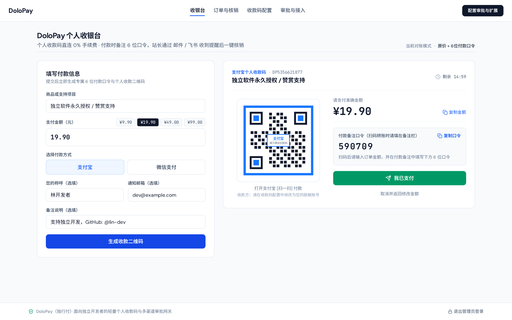
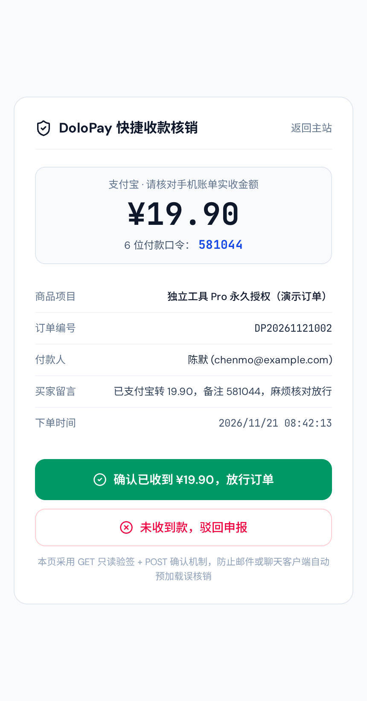
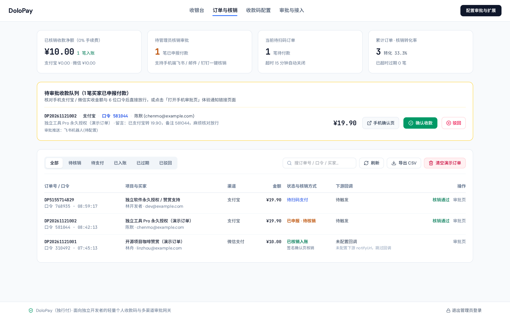
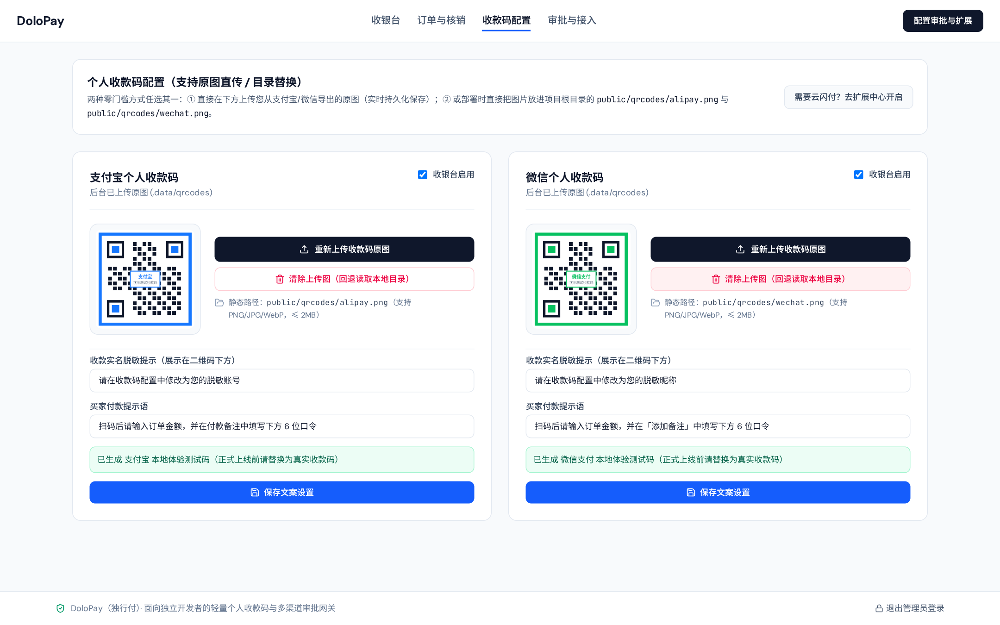
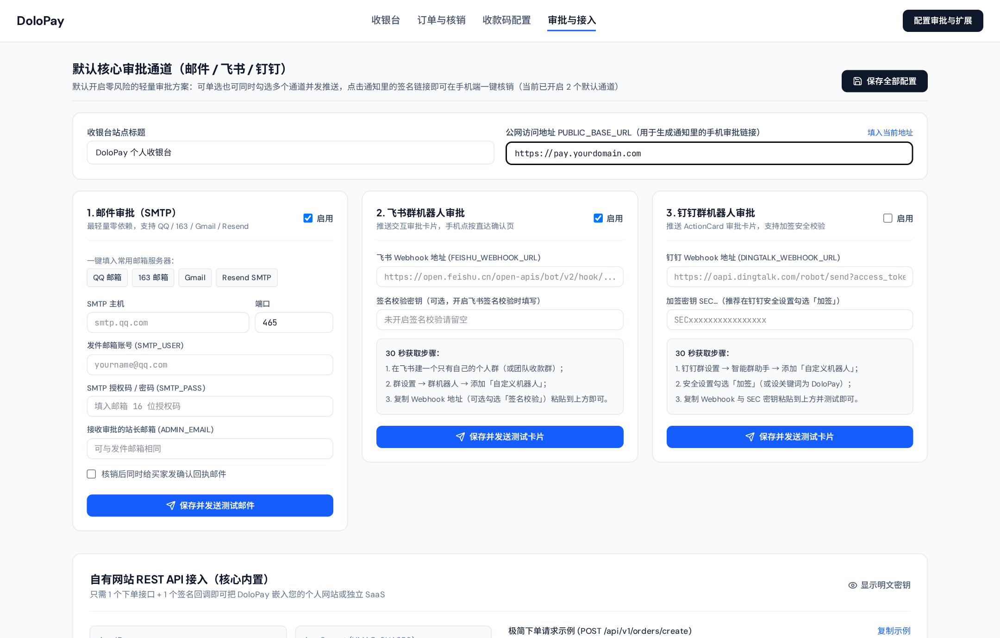
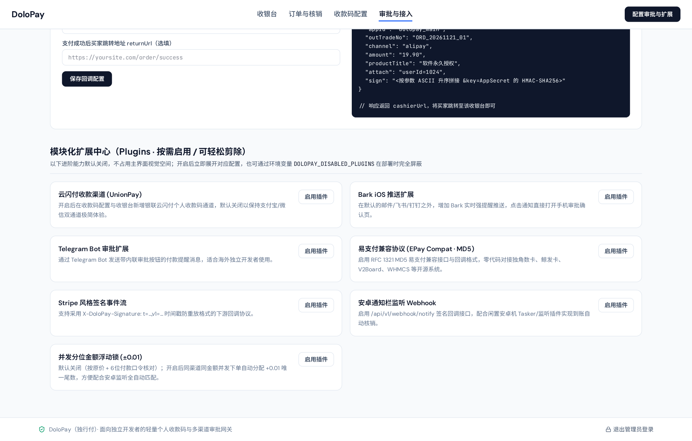

<div align="center">

**简体中文** | [English](./README_EN.md)

# DoloPay（独行付）

**专为独立开发者打造的轻量级个人收款码与多渠道审批网关**  
*Lightweight Personal QR Code Payment & Multi-Channel Approval Gateway for Indie Developers*

[](./LICENSE)
[](#)
[](#三3-分钟开箱即用部署指南)
[](#五模块化扩展与按需裁剪指南)

**无需营业执照 · 0% 手续费直达个人支付宝/微信 · 默认邮件 / 飞书 / 钉钉一键核销（零风控）**  
默认极简开箱，3 分钟上线收款；云闪付、易支付协议、Stripe Webhook、Bark/Telegram 与安卓监听均以独立插件按需启停、轻松裁剪。

<br />



</div>

---

## 一、 实际使用场景与架构定位

绝大多数独立开发者、开源作者和个人站长在商业化初期，每天往往只有**几笔到几十笔收款**（卖软件授权、付费内容、API 额度、咖啡赞赏等）：
- 申请企业支付资质门槛高、维护成本重；
- 第三方聚合代收抽成高，还存在 T+N 冻结或跑路风险；
- 长期挂闲置安卓机监听通知栏不仅容易断网掉线，也存在额外的账号风控顾虑。

因此，**DoloPay v3 采用「极简核心 + 模块化插件扩展」分层设计**：

```text
┌────────────────────────────────────────────────────────────────────────────┐
│  核心开箱层（默认开启，0 噪音，3 分钟上手）                                   │
│  • 收款渠道：个人支付宝 + 微信支付（支持后台传原图 / 目录替换图片）             │
│  • 对账方式：原价收款 + 6 位简短付款口令（不改动买家支付金额，体验最自然）       │
│  • 审批通道：邮件 (SMTP) / 飞书机器人 / 钉钉机器人（支持单选或多渠道同时推送）   │
│  • 手机审批：点击通知里的 HMAC 签名链接 -> 独立确认页点一次按钮通过或驳回        │
│  • 开放接口：简洁 DoloPay REST API v1 + 签名回调到您自己的业务站点             │
├────────────────────────────────────────────────────────────────────────────┤
│  模块化扩展层（默认关闭，后台一键开启，或通过环境变量/删注册项彻底剪除）         │
│  • 支付渠道扩展：云闪付 (unionpay)                                          │
│  • 审批通知扩展：Bark iOS 强提醒 (bark)、Telegram Bot (telegram)             │
│  • 协议兼容扩展：易支付兼容协议 MD5 (epay，对接独角数卡/V2Board)、Stripe (stripe)│
│  • 自动对账扩展：安卓通知监听 Webhook (androidListener) + 分位浮动锁 (centFloat)│
└────────────────────────────────────────────────────────────────────────────┘
```

---

## 二、 界面预览与核心流程

### 1. 个人收银台（原价收款 + 6 位付款口令）
买家选择支付宝或微信扫码后，按订单原价转账并备注 6 位口令，点击「我已支付」即实时推送提醒至站长手机，核销后页面每 3 秒自动同步放行。


### 2. 手机端快捷审批确认页（邮件 / 飞书 / 钉钉直达）
点击通知里的 HMAC 签名链接即可在手机浏览器直接核对实收金额与 6 位口令，一键放行或驳回。页面采用 **`GET` 只读验签 + `POST` 按钮确认** 两步防误触机制，避免邮件或聊天软件预加载链接导致误核销。

<div align="center">
  
</div>

### 3. 订单账本与待核销队列
后台顶部一眼掌握已核销净额、待审批笔数、待扫码订单与转化率；待核销队列置顶展示，支持直接核销、打开手机确认页预览、掉单补单、重发下游 Webhook 及防公式注入的安全 CSV 导出。



### 4. 个人收款码配置（原图直传 / 静态目录双模式）
支持后台直接上传支付宝/微信导出的原图（PNG/JPG/WebP，魔数校验 ≤ 2MB），也支持直接放入 `public/qrcodes/` 目录开箱生效；内置一键生成体验样张码，方便未导出收款码前快速本地联调。



### 5. 默认核心审批通道（邮件 SMTP / 飞书 / 钉钉并发推送）
内置 QQ / 163 / Gmail / Resend 邮箱一键预设以及飞书、钉钉 30 秒配置指引，支持单选或多渠道同时推送，并自带一键发送测试卡片验证连通性。



### 6. 自有网站 REST API 与模块化扩展中心
所有进阶插件（云闪付、Bark、Telegram、易支付 MD5、Stripe Webhook、安卓监听、分位浮动锁）默认折叠关闭，按需在后台一键启用或通过环境变量彻底屏蔽。



---

## 三、 3 分钟开箱即用部署指南

### 第 1 步：克隆并启动服务

环境要求：Node.js `>= 20.x`

```bash
git clone https://github.com/your-org/dolopay.git
cd dolopay
npm install
cp .env.example .env

# 开发/测试运行（默认端口 3000）
npm run dev

# 生产构建并启动
npm run build
NODE_ENV=production npm start
```

> **首次管理员登录说明**：  
> 您可以在 `.env` 中设置 `DOLOPAY_ADMIN_PASSWORD=您的强口令`；如果未填写，首次打开管理后台（订单与核销 / 收款码配置 / 审批与接入）时，网页会自动引导您设置一次管理员口令，并以 `scrypt` 随机加盐哈希保存在本地 `.data/dolopay-state.json` 中。

---

### 第 2 步：配置您自己的个人收款码（两种方式任选其一）

先从手机导出您的个人收款码原图：
- **支付宝**：打开支付宝 → 顶部「收付款」→「二维码收款」→「保存图片」
- **微信**：打开微信 → 右上角 `+` →「收付款」→「二维码收款」→「保存收款码」

**方式 A：管理后台直接上传（最推荐，无需动服务器文件）**
1. 进入管理后台 **「收款码配置」** 标签页；
2. 点击支付宝 / 微信卡片中的 **「上传个人收款码原图」**，选择刚保存的 PNG / JPG / WebP 原图（≤ 2MB）；
3. 填写脱敏收款提示（如 `张*明`），收银台立即展示您的真实收款码。

**方式 B：直接替换本地静态目录（适合 Git / Docker 自动化部署）**
1. 将两张收款码图片重命名后直接放入项目的 `public/qrcodes/` 目录：
   - `public/qrcodes/alipay.png`（也支持 `.jpg` / `.webp`）
   - `public/qrcodes/wechat.png`（也支持 `.jpg` / `.webp`）
2. 刷新收银台页面即可自动识别生效（如果同时在后台上传过图片，以后台上传的 `.data/qrcodes/` 为优先）。

---

### 第 3 步：配置审批通知（邮件 / 飞书 / 钉钉，任选其一或同时开启！）

> 无论是**邮件**、**飞书**还是**钉钉**，都支持直接在 **「审批与接入」** 网页后台填写并点击 **「保存并发送测试」** 一键验证，也可以写入 `.env` 启动自动生效。
>
> **记得填写 `PUBLIC_BASE_URL`**（例如 `https://pay.yourdomain.com`），以便生成的手机端一键审批链接能在公网直接点开，同时可防止审批链接受外部请求头污染。

#### 方案 A：邮件审批（SMTP · 最轻量，几乎零门槛）

以最常见的 **QQ 邮箱** 为例（同样支持 163 邮箱、Gmail、Resend SMTP）：
1. 登录网页版 QQ 邮箱 →「设置」→「账号」→ 向下找到 **POP3/IMAP/SMTP 服务**，开启「IMAP/SMTP 服务」，按提示获取 **16 位授权码**（注意：不是 QQ 登录密码）。
2. 在后台 **「审批与接入 → 邮件审批」** 点击「QQ 邮箱」快捷预设，或写入 `.env`：

```env
PUBLIC_BASE_URL=https://pay.yourdomain.com
SMTP_HOST=smtp.qq.com
SMTP_PORT=465
SMTP_USER=your_qq@qq.com
SMTP_PASS=你的16位授权码
ADMIN_EMAIL=your_qq@qq.com
```

常用邮箱参数速查：

| 邮箱服务商 | `SMTP_HOST` | `SMTP_PORT` | `SMTP_USER` / `SMTP_PASS` 说明 |
| :--- | :--- | :--- | :--- |
| **QQ 邮箱** | `smtp.qq.com` | `465` | QQ 邮箱地址 / 网页设置获取的 16 位授权码 |
| **163 邮箱** | `smtp.163.com` | `465` | 163 邮箱地址 / 开启 SMTP 后的授权密码 |
| **Gmail** | `smtp.gmail.com` | `465` | Gmail 地址 / Google 账号「应用专用密码」 |
| **Resend** | `smtp.resend.com` | `465` | 用户名固定填 `resend` / 密码填 Resend API Key（免费 3,000 封/月） |

#### 方案 B：飞书群机器人审批（30 秒配好，手机体验极佳）

1. 在飞书创建一个只有您自己的个人群（或收款通知群）；
2. 点击群右上角「设置」→「群机器人」→「添加机器人」→ 选择 **「自定义机器人」**；
3. 复制生成的 **Webhook 地址**（推荐同时勾选「签名校验」并复制密钥）；
4. 粘贴到后台「审批与接入 → 飞书群机器人」并点击 **「保存并发送测试卡片」**，或写入 `.env`：

```env
FEISHU_WEBHOOK_URL=https://open.feishu.cn/open-apis/bot/v2/hook/xxxxxxxx
FEISHU_SECRET=可选签名密钥
```

#### 方案 C：钉钉群机器人审批（30 秒配好，支持官方加签）

1. 在钉钉建一个个人/团队收款群 → 群设置 →「智能群助手」→ 添加 **「自定义机器人」**；
2. 安全设置推荐勾选 **「加签」**，复制 `SEC...` 开头的加签密钥与 Webhook 地址；
3. 粘贴到后台「审批与接入 → 钉钉群机器人」并点击 **「保存并发送测试卡片」**，或写入 `.env`：

```env
DINGTALK_WEBHOOK_URL=https://oapi.dingtalk.com/robot/send?access_token=xxxxxxxx
DINGTALK_SECRET=SECxxxxxxxxxxxxxxxx
```

> **多渠道并发支持**：您可以同时勾选启用「邮件 + 飞书 + 钉钉」，买家点击「我已支付」后服务端将并发推送至全部已配置通道（内置 60 秒单订单冷却防刷与 IP 限流）。

---

## 四、 自有网站接入 REST Open API

如果您想把 DoloPay 接入自己的 SaaS、博客或小工具网站，只需两步：

### 1. 创建收款单 (`POST /api/v1/orders/create`)

在后台「审批与接入」复制 `AppID` 与 `AppSecret`，按参数名 **ASCII 字典序** 拼接 `k1=v1&k2=v2...&key=<AppSecret>` 后计算 `HMAC-SHA256` 填入 `sign`：

```json
{
  "appId": "dolopay_main",
  "outTradeNo": "ORD_20261121_001",
  "channel": "alipay",
  "amount": "19.90",
  "productTitle": "Pro 永久授权",
  "attach": "userId=1024",
  "notifyUrl": "https://api.yoursite.com/webhooks/dolopay",
  "returnUrl": "https://yoursite.com/order/success",
  "sign": "<64位 HMAC-SHA256 十六进制签名>"
}
```

成功响应返回 `data.cashierUrl`，直接将买家跳转至该收银台链接即可。

### 2. 接收核销回调 (`notifyUrl`)

管理员在手机确认收款（或安卓监听自动核销）后，DoloPay 会向您的 `notifyUrl` 发送 `POST` JSON 请求，并携带以下请求头供您验签与幂等去重：
- `X-DoloPay-App-Id`
- `X-DoloPay-Timestamp`
- `X-DoloPay-Signature`（与下单一致的 `HMAC-SHA256` 签名）
- `Idempotency-Key`

---

## 五、 模块化扩展与按需裁剪指南

所有进阶能力均注册在 `src/core/pluginRegistry.ts`，**默认全部关闭**。您既可以在管理后台「审批与接入 → 模块化扩展中心」一键开关，也可以通过 `.env` 控制：

| 插件 ID | 功能说明 | 启用方式 |
| :--- | :--- | :--- |
| `unionpay` | 云闪付个人收款码渠道 | 后台开启，并上传图片或放入 `public/qrcodes/unionpay.png` |
| `bark` | Bark (iOS) 实时强提醒审批推送 | 后台开启，填入 `BARK_PUSH_URL` |
| `telegram` | Telegram Bot 带内联按钮审批通知 | 后台开启，填入 `TELEGRAM_BOT_TOKEN` & `TELEGRAM_CHAT_ID` |
| `epay` | **易支付兼容协议 (MD5)**，零代码对接独角数卡 / V2Board / WHMCS | 后台开启，创建易支付应用后把 `/api/v1/epay/`、PID、KEY 填入插件 |
| `stripe` | Stripe 风格时间戳签名 Webhook (`X-DoloPay-Signature: t=...,v1=...`) | 后台开启，新建 Stripe 协议应用 |
| `androidListener` | **安卓通知栏自动监听 Webhook** (`POST /api/v1/webhook/notify`) | 后台开启，配置 `DOLOPAY_ANDROID_SECRET` 与 Tasker/监听端 |
| `centFloat` | **并发分位金额浮动锁 (±0.01)**，解决同额并发自动匹配问题 | 建议在开启安卓自动监听且并发较高时开启 |

### 通过环境变量预设或彻底剪除扩展

```env
# 1. 启动时默认开启云闪付 + 易支付协议
DOLOPAY_ENABLED_PLUGINS=unionpay,epay

# 2. 部署时彻底屏蔽不需要的扩展（后台开关将被锁定不可开启）
DOLOPAY_DISABLED_PLUGINS=stripe,bark,telegram
```

二次开发者如需从源码级彻底移除某个扩展，只需在 `src/core/pluginRegistry.ts` 中删除对应注册项即可，完全不影响核心收银与邮件/飞书/钉钉审批流程。

---

## 六、 给个人开发者的公网部署安全清单（3 条铁律）

> 遵循**柯克霍夫原则（Kerckhoffs's Principle）**，系统的安全性建立在私有密钥之上而非源码保密。只要在公网部署时落实以下 **3 条铁律**，即便攻击者拿着完整源码抓包分析，也无法伪造任何一笔核销：

1. **铁律一：公网必须开启 HTTPS（禁止明文 HTTP 暴露后台与审批页）**  
   务必在 DoloPay（`127.0.0.1:3000`）前端套一层 **Caddy**（自动申请免费 Let's Encrypt 证书）或 **Nginx + HTTPS**，保护管理员口令、手机端审批签名链接和下游回调载荷在公网传输不被窃听或劫持。
2. **铁律二：启动前在 `.env` 固定 `PUBLIC_BASE_URL` 与强口令 `DOLOPAY_ADMIN_PASSWORD`**  
   - 显式设置 `PUBLIC_BASE_URL=https://pay.yourdomain.com`，彻底锁死发往邮件/飞书/钉钉的审批确认页域名，杜绝外部伪造 `Host` / `X-Forwarded-Host` 请求头风险；
   - 提前设置 ≥ 12 位随机强口令 `DOLOPAY_ADMIN_PASSWORD`（以及固定的 `DOLOPAY_SESSION_SECRET` / `DOLOPAY_APPROVAL_SECRET`），避免公网首次启动窗口被陌生人抢先初始化后台密码。
3. **铁律三：严禁泄漏 `.env` 与 `.data/`，并妥善做好本地数据备份**  
   `.env` 包含 SMTP 授权码与机器人密钥，`.data/dolopay-state.json` 与 `.data/qrcodes/` 保存订单流水与收款码原图——两者均已在 `.gitignore` 中排除，切勿提交到公开仓库；建议通过定时任务每日备份 `.data/` 目录，并确保目录权限为仅当前运行用户可读写（`chmod 700 .data`）。

---

## 七、 生产环境纵深安全防线与部署建议

### 1. 内置纵深安全机制（已代码级落地）

| 防线层级 | 防护机制与实现细节 |
| :--- | :--- |
| **身份认证与会话** | 管理员口令采用 `scrypt` 随机 16 字节盐哈希 + `crypto.timingSafeEqual` 常数时间比对；会话 Token 仅存放在前端 React 内存中（不写入 `localStorage`），防范持久化 XSS 窃取凭证；登录接口内置 IP 滑窗限流。 |
| **手机端两步审批防误触** | 邮件/飞书/钉钉通知链接指向 `/approve?orderId=...&token=...`，采用 **`GET /api/v1/approve/inspect`（纯只读验签）+ `POST /api/v1/approve/decide`（人工点击确认）** 两步设计，防止邮箱或聊天客户端自动预加载 URL 造成误核销；审批 Token 内嵌过期时间戳并强制校验。 |
| **防 Host 污染与反刷通知** | 生成发往站长手机的审批链接绝不采信未认证买家请求头；买家点击「我已支付」受 **IP 限流 + 60 秒单订单冷却 + 单笔上限 3 次推送** 三重限制，且自动拒绝已超时订单。 |
| **防 SSRF 与伪协议 XSS** | 所有出站 Webhook（下游 `notifyUrl`、飞书/钉钉/Bark）强制拦截 `localhost`、私网/环回/云元数据 IPv4（`169.254.169.254` 等）、IPv6 字面量与内嵌凭据 URL，并在 `fetch` 中启用 `redirect: 'error'` 阻断 30x 跳转探测；`returnUrl` 前后端双重校验仅允许 `http://` / `https://`。 |
| **文件上传与导出安全** | 收款码原图上传同时校验 MIME、≤ 2MB 体积与二进制文件头魔数（PNG / JPEG / WebP），文件写入严格限制在 `.data/qrcodes/` 目录内（防路径穿越）；订单账本 CSV 导出自动对 `=`、`+`、`-`、`@` 等公式触发前缀转义，防范表格公式注入。 |
| **可选插件隔离与防重放** | 易支付兼容与安卓监听接口默认关闭（未启用直接返回 `403`）；安卓监听强制 `HMAC-SHA256` + ±300 秒防重放窗口 + 设备流水号幂等去重；可通过 `DOLOPAY_DISABLED_PLUGINS` 在部署层彻底锁定屏蔽不需要的扩展。 |

### 2. 推荐生产部署拓扑（Caddy 反向代理 + PM2 保活）

**① Caddy 极简 HTTPS 配置（`/etc/caddy/Caddyfile`，自动签发续期 TLS 证书）：**

```caddyfile
pay.yourdomain.com {
    reverse_proxy 127.0.0.1:3000 {
        header_up X-Real-IP {remote_host}
        header_up X-Forwarded-For {remote_host}
        header_up X-Forwarded-Proto {scheme}
    }
}
```

**② PM2 守护进程启动（开机自启与异常自动拉起）：**

```bash
npm run build
NODE_ENV=production pm2 start "npm start" --name dolopay
pm2 save && pm2 startup
```

> **进阶建议**：如同时启用「易支付兼容」或自有网站 API，请在云防火墙仅放行 `80/443` 端口，不要直接将 `3000` 端口暴露在公网；对于飞书和钉钉群机器人，强烈建议开启官方「签名校验 / 加签（`SEC...`）」。

---

## 八、 常用运维与测试命令

```bash
# 运行核心引擎、插件机制与安全校验单元测试
npx --yes tsx --test src/core/dolopayEngine.test.ts

# 类型检查与前端构建
npm run lint
npm run build
```

---

## 九、 开源许可 (License)

Copyright © 2026 **zpjio**. 本项目基于 [**Apache-2.0 License**](./LICENSE) 开源（归属声明见 [`NOTICE`](./NOTICE)）。本软件按“原样（AS IS）”提供，部署者须自行确保业务符合当地法律法规及对应支付平台条款。
