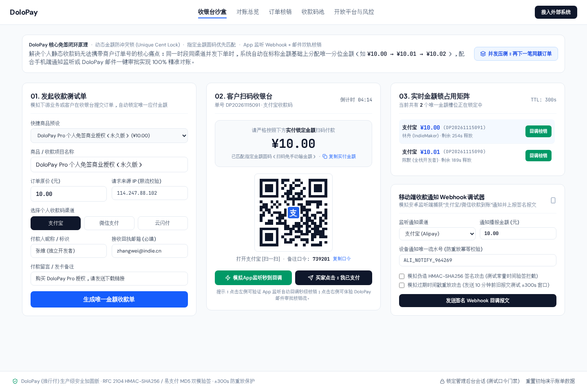
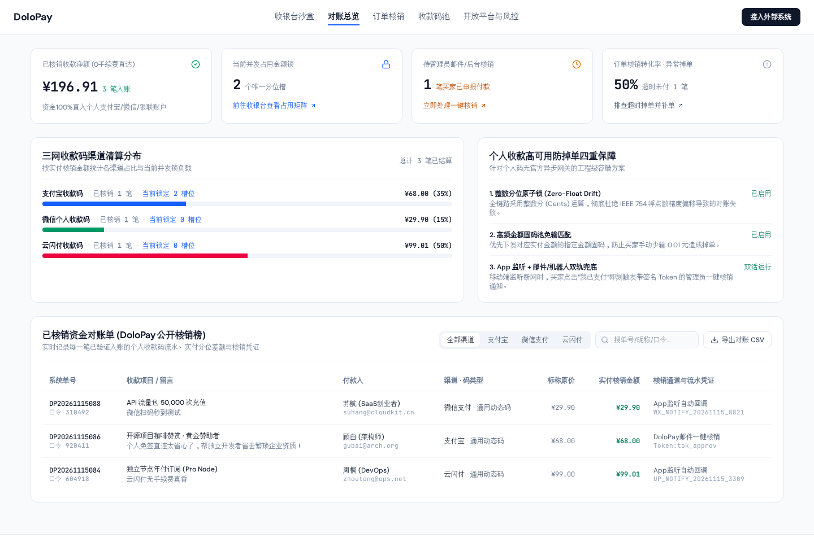
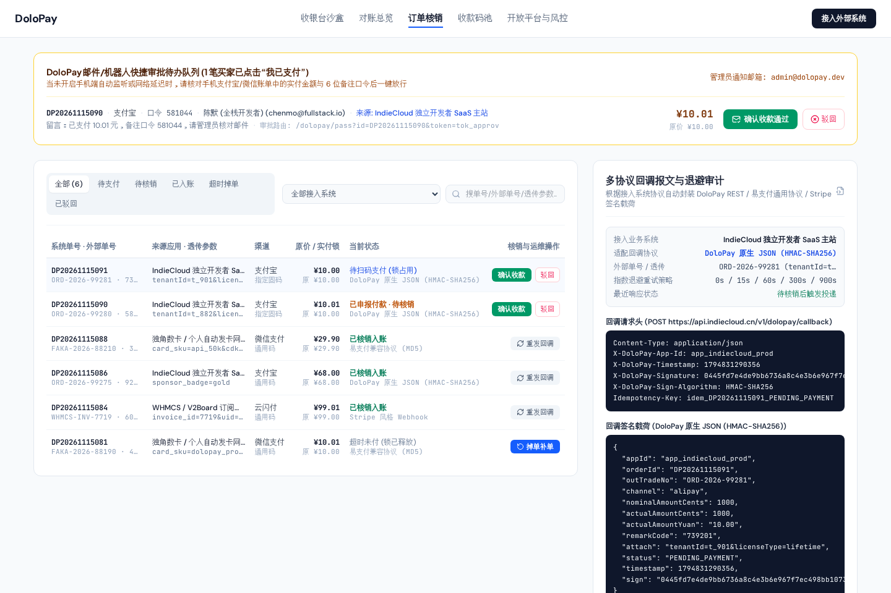
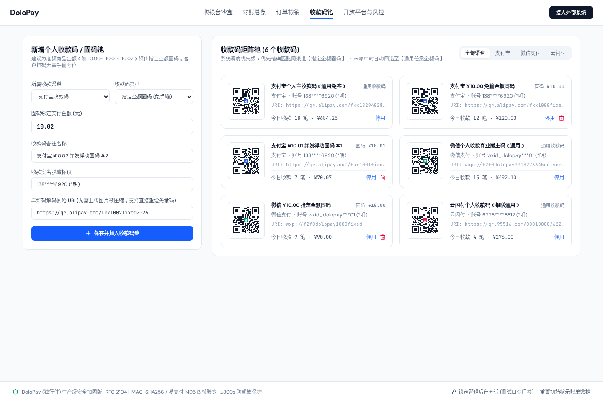
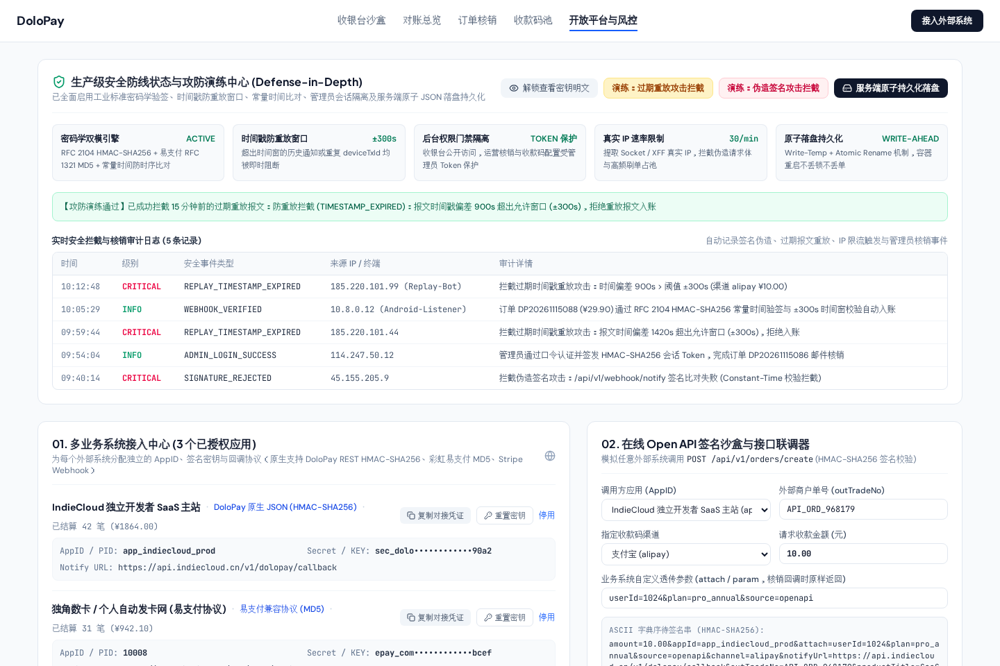

<div align="center">

[简体中文](./README.md) | **English**

# DoloPay (独行付)

**Personal QR Code Payment & Multi-Protocol Open Gateway for Indie Hackers**  
*Zero-Contract Personal Collection & Automated Reconciliation Gateway*

[](./LICENSE)
[](./tsconfig.json)
[](#)
[](#4-external-system-integration-guide-open-api--plugins)

**No Business License Required · 0% Gateway Fee · 100% Real-Time Direct Settlement to Personal Alipay / WeChat Pay / UnionPay Accounts**  
Built-in integer-cent atomic collision-lock engine, high-frequency fixed-amount QR pool matching, dual-track settlement via mobile notification listener and email/IM bot approval, and zero-code EPay compatibility.

</div>

---

## 📸 Screenshots

### 1. Cashier Sandbox & Live Amount Lock Matrix
> One-click concurrent same-amount stress testing, real-time checkout countdown, unique cent-lock occupancy monitor, and mobile notification Webhook signature debugger.



### 2. Full Operations Console & Open Gateway Matrix

| Overview Ledger & Channel Settlement | Order Approval & Multi-Protocol Webhook Audit |
| :---: | :---: |
|  |  |
| **Personal QR Code & Fixed-Amount Pool** | **Open Platform, App Registry & SDK Generator** |
|  |  |

---

## 1. Why DoloPay?

Indie hackers and solo developers often face a dilemma when monetizing early products: official enterprise payment APIs require a registered business entity and corporate bank account, while third-party payment aggregators charge high commissions, impose T+N settlement holds, or carry platform shutdown risks.

Personal static QR codes settle 100% directly to your personal account with zero transaction fees, but have two classic engineering limitations:
1. **No Order ID Passthrough**: Payment notifications only report "Received X.XX". When multiple buyers purchase the same priced item (e.g., `¥10.00`) concurrently, you cannot tell which customer paid.
2. **No Standard Async Webhook Gateway**: Static QR codes cannot automatically trigger downstream SaaS provisioning, digital key delivery, or subscription activation.

**DoloPay (独行付)** is engineered for financial-grade reliability, combining **Integer-Cent Atomic Amount Locks + High-Frequency Fixed QR Pool Priority Matching + Mobile Listener & Email/IM Dual-Track Settlement + Multi-Protocol Open Gateway** to solve personal QR automation end-to-end.

---

## 2. Core Architecture & Four Anti-Drop Mechanisms

```text
+-----------------------------------------------------------------------------------+
│                     Downstream Business Systems (Applications)                    │
│   [Custom SaaS / Indie Site]   [Card Shops / V2Board]        [WHMCS / Global Sub] │
+-------------+------------------------------+------------------------------+-------+
              │ 1. DoloPay REST v1           │ 2. EPay Compat (MD5)         │ 3. Stripe Webhook
              v                              v                              v
+-----------------------------------------------------------------------------------+
│                          DoloPay Open Gateway (server.ts)                         │
│  - Multi-App Auth (AppID + AppSecret)   - ASCII Canonical Sign & Idempotency Key  │
│  - Custom Passthrough (attach / param)  - Exponential Backoff (0/15/60/300/900s)  │
+--------------------------------------------+--------------------------------------+
                                             │
                                             v
+-----------------------------------------------------------------------------------+
│                      DoloPay Core Collision & Dispatch Engine                     │
│  [Cent Atomic Lock] Concurrent ¥10.00 -> Locks ¥10.00 / ¥10.01 / ¥10.02 (TTL)     │
│  [QR Pool Dispatch] Exact Match [Fixed-Amount QR] -> Fallback [Universal + Code]  │
│  [Rate & Risk Ctrl] Per-IP Pending Cap + Pool Exhaustion Guard + Zero Float Drift │
+----------------------+-----------------------------------------+------------------+
                       │                                         │
       Track A: Automated Instant Callback (Primary)   Track B: One-Tap Fallback (HA)
                       v                                         v
+--------------------------------------+   +----------------------------------------+
│ Mobile Payment Listener (Android)    │   │ Email / Feishu / Bark / Telegram Bot   │
│ Captures App Notification -> HMAC    │   │ Buyer clicks "Paid" -> Signed One-Tap  │
+--------------------------------------+   +----------------------------------------+
```

### 1. Unique Cent Lock Pool (Integer-Cent Arithmetic)
- **Zero Floating-Point Drift**: All calculations run strictly in integer cents (e.g., `1001` cents = `¥10.01`), completely eliminating IEEE 754 floating-point precision bugs.
- **Concurrent Collision Prevention**: When `Alipay ¥10.00` is locked, concurrent orders automatically allocate `¥10.01`, `¥10.02`, etc. according to the configured strategy (increment or decrement).
- **Automatic TTL Reclamation**: Locks are released immediately upon settlement or when an order expires (default: 300 seconds).

### 2. Fixed-Amount QR Pool + Universal QR Dual-Layer Dispatch
- **Eliminates Manual Entry Errors**: Buyers scanning a universal QR code might forget to type the `.01` cent offset.
- **Fixed QR Priority**: Pre-upload fixed-amount QR codes (e.g., `¥10.00 ~ ¥10.05`) in the QR Pool. Matched orders require zero manual amount entry; unmatched amounts gracefully fall back to the universal QR code with a 6-digit remark verification code.

### 3. Mobile Listener Webhook + Email/IM Bot Dual-Track Verification
- **Fully Automated Track**: Run an Android `NotificationListenerService` / `Tasker` script on a spare device to capture Alipay/WeChat incoming notifications and report them with an `HMAC-SHA256` signature and unique `deviceTxId` to `/api/v1/webhook/notify`.
- **DoloPay Quick Approval + Multi-Channel Alerts**: Even if the listener device goes offline, clicking "I Have Paid" triggers instant approval links (with signed `approvalToken`) delivered via Email, **Feishu, Bark (iOS critical alerts), DingTalk, and Telegram**.

### 4. Three Production-Ready Integration Protocols
- **DoloPay REST Open API v1**: Standard JSON + ASCII lexicographical HMAC-SHA256 signature + `Idempotency-Key` header.
- **EPay Compatibility (`EPAY_COMPAT`)**: Zero-code drop-in integration with any open-source EPay plugin ecosystem (card shops, V2Board, SSPanel, WHMCS, WooCommerce).
- **Stripe-Style Event Stream (`STRIPE_WEBHOOK`)**: Signed with `X-DoloPay-Signature: t=...,v1=...` timestamped HMAC-SHA256 headers.

---

## 3. Quick Start & Local Development

### 1. Prerequisites
- Node.js `>= 20.x`
- npm `>= 9.x`

### 2. Installation & Startup

```bash
# Clone the repository
git clone https://github.com/your-org/dolopay.git
cd dolopay

# Install dependencies
npm install

# Start the full-stack dev server (Express Open Gateway + Vite Console on port 3000)
npm run dev
```

### 3. Run Core Engine Unit Tests

```bash
npx --yes tsx --test src/core/dolopayEngine.test.ts
```

---

## 4. External System Integration Guide (Open API & Plugins)

### Option A: Zero-Code Integration via EPay Compatibility Mode

Create an application in **Open Platform & Risk Control** using the `EPAY_COMPAT` protocol, then paste these three values into your store or panel plugin settings:

| Field | Value |
| :--- | :--- |
| **API URL** | `https://your-dolopay-domain.com/api/v1/epay/` |
| **Merchant ID (PID)** | Assigned `AppID` (e.g., `10008`) |
| **Merchant Key (KEY)** | Assigned `AppSecret` |

---

### Option B: Standard REST Open API v1 (Custom Backends)

#### 1. Create a Cent-Locked Payment Order
- **Endpoint**: `POST /api/v1/orders/create`
- **Content-Type**: `application/json`

**Request Body:**

```json
{
  "appId": "app_indiecloud_prod",
  "outTradeNo": "ORD_20261115_001",
  "channel": "alipay",
  "amount": "10.00",
  "productTitle": "DoloPay Pro Commercial License",
  "attach": "userId=1024&plan=pro_annual",
  "notifyUrl": "https://api.yoursite.com/webhooks/dolopay",
  "sign": "adab34d558cf25435d602842d3f44eef78b37de18ecee44a49d188b75c11600e"
}
```

**Signature Algorithm (`computeCanonicalOpenApiSign`):**
1. Filter out empty values, `sign`, and `sign_type`.
2. Sort remaining keys in **ASCII ascending order** and join as `k1=v1&k2=v2...`.
3. Append `&key=<AppSecret>` to build the canonical signing string.
4. Compute the `HMAC-SHA256` hex digest and assign it to `sign`.

**Success Response Example:**

```json
{
  "code": 0,
  "msg": "success",
  "data": {
    "orderId": "DP20261115101",
    "outTradeNo": "ORD_20261115_001",
    "channel": "alipay",
    "nominalAmountYuan": "10.00",
    "actualPayAmountYuan": "10.01",
    "floatDeltaCents": 1,
    "qrMatchType": "FIXED_EXACT",
    "qrPayloadUrl": "https://qr.alipay.com/fkx1001fixed2026",
    "remarkCode": "581044",
    "attach": "userId=1024&plan=pro_annual",
    "expiresAt": 1794811800000,
    "cashierUrl": "/?orderId=DP20261115101"
  }
}
```

#### 2. Receiving Async Webhook Notifications
Once settled, DoloPay sends a `POST` request to your `notifyUrl` (retrying on failure at `0s / 15s / 60s / 300s / 900s`):

- **Headers**:
  - `X-DoloPay-App-Id`: `app_indiecloud_prod`
  - `X-DoloPay-Timestamp`: `1794811542137`
  - `X-DoloPay-Signature`: `<64-char hex signature>`
  - `Idempotency-Key`: `idem_DP20261115101_PAID`

---

## 5. Production Defense-in-Depth & Deployment Checklist

### 1. Five Built-In White-Box Security Layers

1. **Dual-Mode Standard Cryptography + Constant-Time Comparison**:
   - **RFC 2104 `HMAC-SHA256`** across `DOLOPAY_REST_V1`, `STRIPE_WEBHOOK`, and mobile listener reports; **RFC 1321 `MD5`** for `EPAY_COMPAT` plugin compatibility.
   - All signature checks use byte-level `constantTimeEqual` comparisons to prevent timing side-channel attacks.
2. **Webhook `±300s` Anti-Replay Window + Device Tx Idempotency**:
   - `/api/v1/webhook/notify` rejects stale timestamps outside `±300s` (`TIMESTAMP_EXPIRED`) and blocks duplicate `deviceTxId` deliveries (`DUPLICATE_TX_ID`), recording all attempts to the security audit log.
3. **Public Cashier vs. Admin Token Isolation + One-Way State Machine**:
   - Public status endpoints never expose `approvalToken` or secrets; buyer "I Have Paid" declarations (`POST /api/v1/orders/:id/mark-paid`) can only transition orders to `AWAITING_APPROVAL`, never `PAID`.
   - Admin views and persistence endpoints require `DOLOPAY_ADMIN_PASSWORD` and HMAC-signed `X-DoloPay-Admin-Token` sessions.
4. **Real Client IP Extraction & Sliding-Window Rate Limiter**:
   - Extracts client IP from proxy headers (`X-Forwarded-For` / `X-Real-IP` / Socket) to enforce per-minute API rate limits and per-IP active cent-lock caps.
5. **Write-Ahead Atomic JSON Persistence**:
   - State mutations persist atomically via `Write-Temp + Atomic Rename` to `.data/dolopay-store.json`, preserving active locks and order ledgers across container or process restarts.

### 2. Three Mandatory Rules Before Public Deployment

> [!IMPORTANT]
> Following **Kerckhoffs's Principle**, security relies on keeping your keys private—not hiding source code. Enforce these three rules before exposing DoloPay to the public internet:

1. **Rotate All Default Secrets**: Set a strong `DOLOPAY_ADMIN_PASSWORD` in `.env`, and rotate `webhookSecretKey` plus every connected app's `AppSecret` in the console.
2. **Always Verify Callback Signatures & Paid Amounts Downstream**: Validate `X-DoloPay-Signature` (or EPay `sign`) using constant-time comparison before fulfilling orders.
3. **Overwrite Proxy IP Headers at Your Reverse Proxy**: Configure Nginx/Caddy/Cloudflare to overwrite `X-Real-IP` and `X-Forwarded-For` with `$remote_addr` so clients cannot spoof headers to bypass rate limits.

---

## 6. License & Compliance

Copyright © 2026 **zpjio**. This project is licensed under the [**Apache License 2.0**](./LICENSE). When using, modifying, or redistributing this software, please comply with the following terms:

- **License & Attribution Files**: The repository root provides the full [`LICENSE`](./LICENSE) text and [`NOTICE`](./NOTICE) attribution file (Copyright holder: **zpjio**). All core TypeScript source files include `SPDX-License-Identifier: Apache-2.0` headers, and `package.json` declares `"author": "zpjio"` and `"license": "Apache-2.0"`.
- **Permissions & Conditions**: Commercial use, modification, distribution, and private/proprietary derivative works are permitted provided that you retain copyright notices, include a copy of [`LICENSE`](./LICENSE) and [`NOTICE`](./NOTICE), and document prominent change notices in any modified files.
- **Third-Party Software & Trademarks**: Open-source dependencies (React, Express, Vite, Tailwind CSS, Lucide, etc.) remain governed by their respective licenses (primarily MIT, ISC, and Apache-2.0). Trademarks such as Alipay, WeChat Pay, UnionPay, Stripe, Feishu, Bark, and Telegram belong to their respective owners and are referenced solely for protocol compatibility and routing.
- **Disclaimer**: Provided on an "AS IS" basis without warranties or conditions of any kind. Operators are solely responsible for complying with local laws and applicable payment-provider terms of service.

