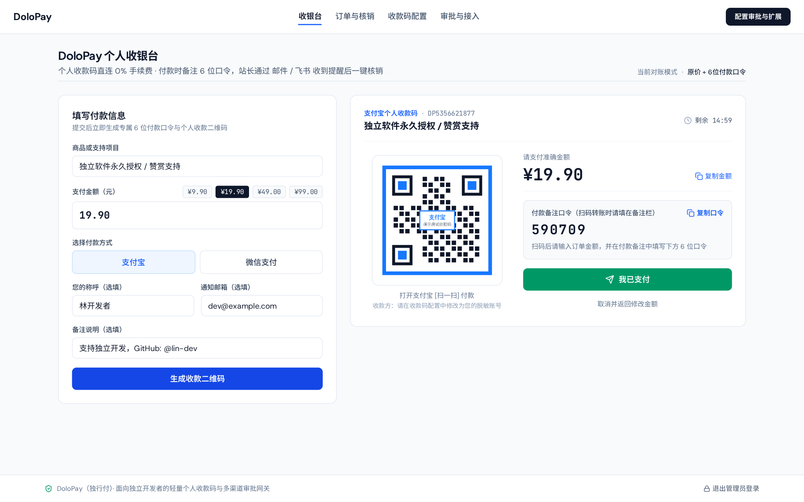
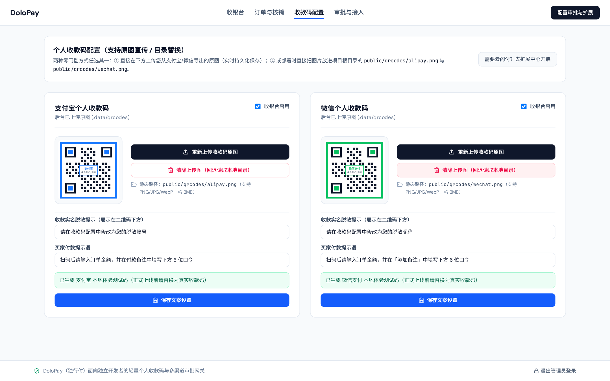
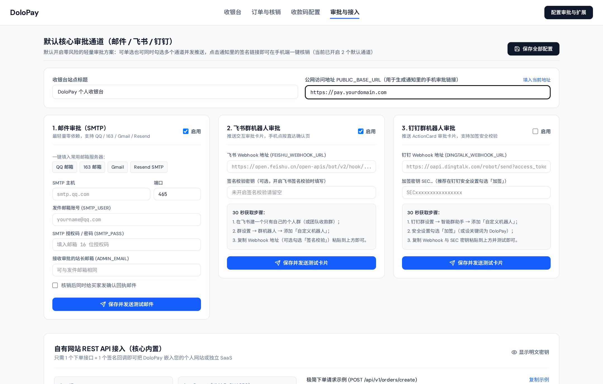
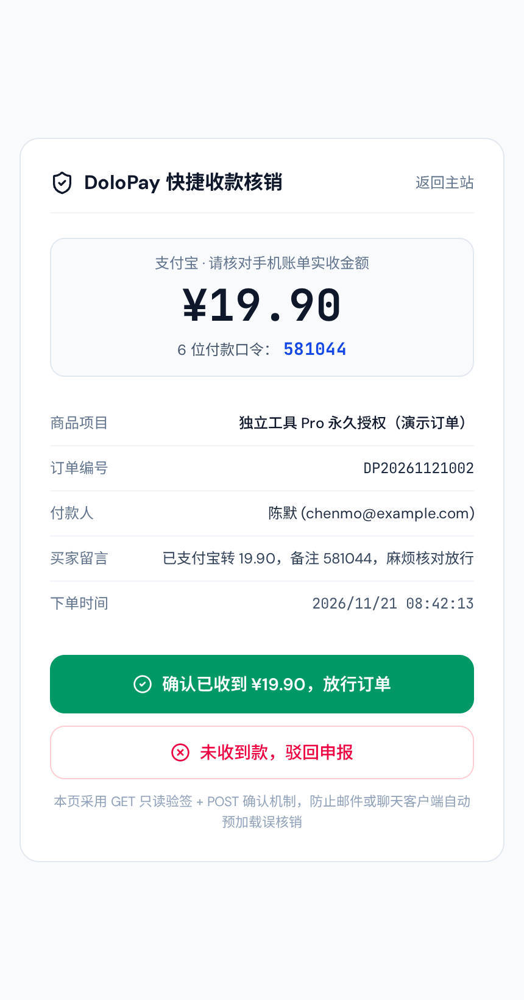
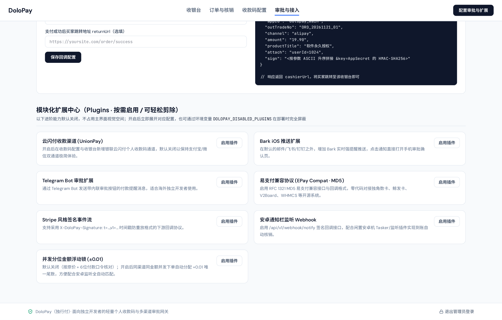

<div align="center">

[简体中文](./README.md) | **English**

# DoloPay

**Lightweight Personal QR Code Payment & Multi-Channel Approval Gateway for Indie Developers**

[](./LICENSE)
[](#)
[](#3-3-minute-out-of-the-box-setup)
[](#5-modular-plugins--pruning-guide)

**No Business License Required · 0% Gateway Fee · Direct to Your Personal Alipay / WeChat**  
Ships clean and minimal out of the box with **Email (SMTP) / Feishu / DingTalk** one-tap signed approval pages. Advanced capabilities (UnionPay, EPay Compat, Stripe Webhook, Bark, Telegram, Android Notification Listener, Cent-Float Lock) live as modular plugins you can toggle on demand or prune cleanly.

<br />



</div>

---

## 1. Architecture: Minimal Core + Modular Plugins

Independent developers typically process a handful to a few dozen orders per day. Running an idle Android notification-listener phone adds reliability headaches and platform risk. DoloPay v3 solves this with a clean two-layer design:

- **Default Core (On Out of the Box)**:
  - **Channels**: Personal Alipay + WeChat Pay (supports Admin UI image upload OR dropping files into `public/qrcodes/`).
  - **Reconciliation**: Exact order amount + 6-digit remark code (no confusing forced amount mutations).
  - **Approval Channels**: Real **Email (SMTP)**, **Feishu Custom Bot**, and **DingTalk Custom Bot** — enable one or fire all concurrently.
  - **Mobile Confirmation Page**: Every notification links to a mobile-first HMAC-signed page (`/approve?orderId=...&token=...`) using two-step `GET` inspect + `POST` decide to prevent email/IM link prefetchers from auto-approving orders.
  - **Open API**: Clean `POST /api/v1/orders/create` + signed `notifyUrl` callbacks.
- **Modular Plugins (Off by Default, Toggle or Prune Anytime)**:
  - `unionpay`, `bark`, `telegram`, `epay` (MD5 EPay Compat), `stripe`, `androidListener`, `centFloat`.

---

## 2. Interface Showcase

| Personal Cashier (Exact Amount + 6-Digit Remark Code) | Orders & Pending Approval Queue |
| :---: | :---: |
|  |  |

| Personal QR Code Setup (Upload or Static Folder) | Multi-Channel Approval (Email / Feishu / DingTalk) |
| :---: | :---: |
|  |  |

### Mobile Two-Step Signed Approval Confirmation Page
Tap the signed link in Email, Feishu, or DingTalk to verify the amount and 6-digit remark code and approve or reject in one tap:

<div align="center">
  
</div>

### REST Open API & Modular Plugins Center



---

## 3. 3-Minute Out-of-the-Box Setup

### Step 1: Clone & Start (Node.js >= 20)

```bash
git clone https://github.com/your-org/dolopay.git
cd dolopay
npm install
cp .env.example .env

npm run dev
# Or production:
npm run build && NODE_ENV=production npm start
```

> **Admin Password**: Set `DOLOPAY_ADMIN_PASSWORD` in `.env`, or leave it blank to set your admin password via the built-in first-run setup wizard (hashed with `scrypt` into `.data/dolopay-state.json`).

### Step 2: Configure Your Personal QR Codes (Pick Either Method)

Export your personal receive QR code images from Alipay and WeChat on your phone, then:

1. **Method A — Upload in Admin UI**: Open **QR Code Setup (`收款码配置`)** and upload your PNG / JPG / WebP QR images directly (persisted in `.data/qrcodes/`).
2. **Method B — Drop into Static Folder**: Place `alipay.png` and `wechat.png` (`.jpg`/`.webp` also supported) inside `public/qrcodes/` and refresh.

### Step 3: Enable Email / Feishu / DingTalk Approval

Set `PUBLIC_BASE_URL` (e.g. `https://pay.yourdomain.com`) in `.env` or Admin UI, then configure one or more channels and click **Save & Send Test**:

- **Email (SMTP)**: Works with QQ Mail (`smtp.qq.com:465`), 163 Mail (`smtp.163.com:465`), Gmail (`smtp.gmail.com:465`), and Resend (`smtp.resend.com:465`, user `resend`).
- **Feishu Bot**: Add a Custom Bot to your Feishu group, copy the Webhook URL (and optional signing secret), and paste into Admin UI or `FEISHU_WEBHOOK_URL` / `FEISHU_SECRET`.
- **DingTalk Bot**: Add a Custom Bot to your DingTalk group with Signing enabled (`SEC...`), and paste into Admin UI or `DINGTALK_WEBHOOK_URL` / `DINGTALK_SECRET`.

---

## 4. REST Open API

Create a signed order via `POST /api/v1/orders/create` (HMAC-SHA256 over ASCII-sorted params + `&key=<AppSecret>`) and redirect the buyer to `data.cashierUrl`. Once you approve the payment on your phone, DoloPay delivers a signed `POST` webhook to your `notifyUrl` with `X-DoloPay-Signature` and `Idempotency-Key`.

---

## 5. Modular Plugins & Pruning Guide

Toggle plugins in Admin UI (**Approval & Plugins**) or via `.env`:

```env
# Pre-enable plugins on startup
DOLOPAY_ENABLED_PLUGINS=unionpay,epay

# Hard-disable & lock unwanted plugins
DOLOPAY_DISABLED_PLUGINS=stripe,bark,telegram
```

Available plugin IDs: `unionpay`, `bark`, `telegram`, `epay`, `stripe`, `androidListener`, `centFloat`.

---

## 6. Public Deployment Security Checklist (3 Iron Rules) & Production Hardening

> Following **Kerckhoffs's Principle**, system security relies on keeping your private keys secret rather than hiding the source code. As long as you enforce the following **3 Iron Rules** in public deployment, even an attacker holding the full source code and capturing network traffic cannot forge a single settlement:

1. **Always Serve Behind HTTPS (Caddy / Nginx)**: Never expose port `3000` over plain HTTP. Put DoloPay behind Caddy (auto-TLS) or Nginx + HTTPS so admin credentials, mobile approval links, and merchant callbacks stay encrypted.
2. **Pin `PUBLIC_BASE_URL` and `DOLOPAY_ADMIN_PASSWORD` in `.env`**: Explicitly set `PUBLIC_BASE_URL=https://pay.yourdomain.com` to prevent Host Header Poisoning on outbound approval links, and set a strong `DOLOPAY_ADMIN_PASSWORD` (plus `DOLOPAY_SESSION_SECRET` and `DOLOPAY_APPROVAL_SECRET`) before first boot.
3. **Protect & Back Up `.env` and `.data/`**: Never commit `.env` or `.data/` (already in `.gitignore`), restrict permissions (`chmod 700 .data`), and back up `.data/` daily.

### Built-In Defense-in-Depth Safeguards
- **Auth & Sessions**: `scrypt` salted password hashing + constant-time verification; admin tokens stay in React memory (never persisted to `localStorage`); login and approval endpoints enforce IP sliding-window rate limits.
- **Two-Step Anti-Prefetch Approval**: Mobile approval links use read-only `GET /api/v1/approve/inspect` followed by explicit `POST /api/v1/approve/decide` with embedded token expiry checks, preventing mail/IM link scanners from auto-settling orders.
- **Anti-Spam & Anti-SSRF**: Buyer payment notifications enforce a 60s per-order cooldown (max 3 pushes); all outbound webhooks block private/loopback/metadata IPv4, IPv6 literals, embedded credentials, and HTTP 30x redirects (`redirect: 'error'`); `returnUrl` strictly enforces `http://` or `https://`.
- **Upload & Export Hygiene**: QR uploads verify both MIME and binary magic bytes (PNG/JPEG/WebP ≤ 2MB) within confined directories; CSV ledger exports neutralize spreadsheet formula injection characters (`=`, `+`, `-`, `@`).

---

## 7. Tests & License

```bash
npx --yes tsx --test src/core/dolopayEngine.test.ts
npm run lint
npm run build
```

Copyright © 2026 **zpjio**. Licensed under the [Apache-2.0 License](./LICENSE) (see [`NOTICE`](./NOTICE)).
